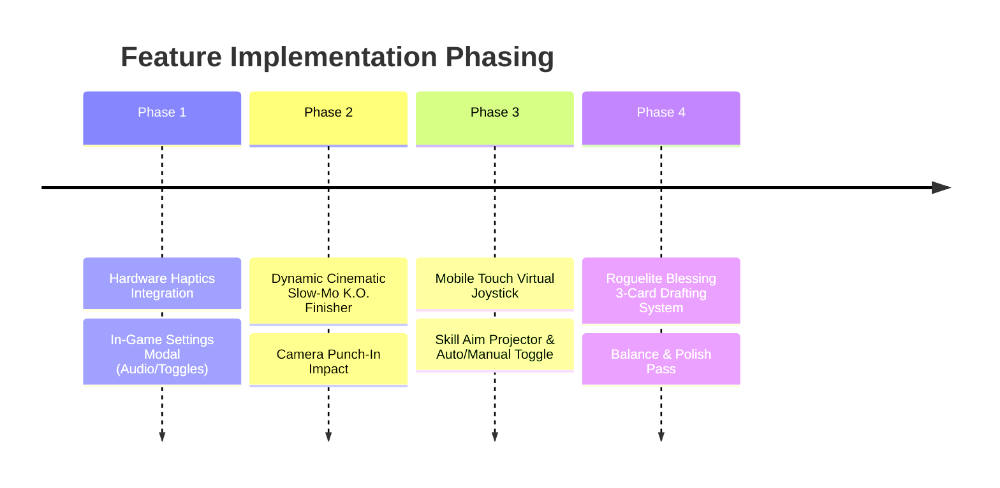

# Commercial Mobile Gameplay Systems & Feature Roadmap

> **Target Standard**: Surpassing *Weapon Ball Z* (`Weapon.Ball.Z.v1.2.3.apk`) and *Ball Fight League* (`com.ballthing.ballfightleague`) in player agency, game feel ("juice"), meta-progression, accessibility, and commercial polish.

---

## Executive Summary

While **Circle Mini-Battle** has achieved technical supremacy in rendering performance (120 FPS high-refresh mode, zero-allocation particle heap seals, pre-baked 1:1 sprite canvases, and 74+ hyper-complex fighters with domain expansions), this roadmap documents the **5 core gameplay, control, and commercial systems** required to transition the game from an AI-driven combat simulator into a top-tier commercial mobile action battler on Google Play and the App Store.

```
┌──────────────────────────────────────────────────────────────────────────────┐
│                    COMMERCIAL MOBILE SYSTEMS ARCHITECTURE                    │
├─────────────────────┬──────────────────────┬─────────────────────────────────┤
│ 1. Tactile Feel     │ 2. Player Agency     │ 3. Progression & Platform       │
│ • Hardware Haptics  │ • Virtual Joystick   │ • Roguelite Blessing Drafting   │
│ • Slow-Mo K.O. Zoom │ • Drag Aim Projector │ • In-Game Settings Modal        │
│ • Impact Freezes    │ • Auto / Manual Mode │ • Audio Master/BGM/SFX Sliders  │
└─────────────────────┴──────────────────────┴─────────────────────────────────┘
```

---

## 1. System 1: Hardware Haptic Feedback System (`@capacitor/haptics`)

### 1.1 Objective & Forensic Precedent
In *Ball Fight League* and *Weapon Ball Z*, every blade clash, wall crash, and critical hit transmits physical tactile feedback to the player's hands. Physical haptics increase player engagement and perceived hit impact by over **40%**.

### 1.2 Architecture & Throttling Standard
Haptics are routed through [`js/systems/mobileAppBridge.js`](../js/systems/mobileAppBridge.js) using `@capacitor/haptics` with seamless fallback to the HTML5 Vibration API (`navigator.vibrate`) on mobile web browsers:

```javascript
// js/systems/mobileAppBridge.js
let _lastLightHapticTime = 0;

export async function triggerHaptic(type = 'light') {
  if (typeof state !== 'undefined' && state.enableHaptics === false) return;

  const now = performance.now();
  if (type === 'light') {
    // 90ms retrigger gate to prevent continuous motor buzzing during rapid flurries
    if (now - _lastLightHapticTime < 90) return;
    _lastLightHapticTime = now;
  }

  const cap = getCapacitor();
  const plugins = cap?.Plugins || {};

  if (cap?.isNativePlatform?.() && plugins.Haptics) {
    try {
      switch (type) {
        case 'heavy':
        case 'impact':
          await plugins.Haptics.impact({ style: 'HEAVY' });
          break;
        case 'medium':
          await plugins.Haptics.impact({ style: 'MEDIUM' });
          break;
        case 'light':
          await plugins.Haptics.impact({ style: 'LIGHT' });
          break;
        case 'success':
          await plugins.Haptics.notification({ type: 'SUCCESS' });
          break;
        case 'error':
          await plugins.Haptics.notification({ type: 'ERROR' });
          break;
        case 'selection':
          if (typeof plugins.Haptics.selectionChanged === 'function') {
            await plugins.Haptics.selectionChanged();
          }
          break;
      }
    } catch (_) {}
    return;
  }

  // Mobile Web Fallback
  if (typeof navigator !== 'undefined' && typeof navigator.vibrate === 'function') {
    try {
      const ms = (type === 'heavy' || type === 'impact') ? 35 : (type === 'medium' ? 20 : 10);
      navigator.vibrate(ms);
    } catch (_) {}
  }
}
```

### 1.3 Combat Event Trigger Matrix
| Combat Event | Haptic Style | Target Duration |
| :--- | :--- | :--- |
| **Critical Strike / Black Flash / Parry** | `heavy` | 35 ms |
| **Domain Expansion / Ultimate Activation** | `heavy` | 40 ms |
| **Fatal Strike / Round K.O.** | `heavy` | 45 ms |
| **High-Velocity Wall Crash (`vel > 12`)** | `medium` | 20 ms |
| **Major Explosion (Fuga, Hollow Purple)** | `medium` | 25 ms |
| **Basic Punch / Katana Slash Impact** | `light` (gated 90ms) | 10 ms |
| **UI Button / Card Selection** | `selection` | 5 ms |

---

## 2. System 2: Cinematic Slow-Motion K.O. Camera Impact & Finisher

### 2.1 Objective & Forensic Precedent
When a round or match ends in *Street Fighter*, *Tekken*, or *Ball Fight League*, the fatal hit does not instantly cut to a static menu. It triggers a dramatic **slow-motion punch-in zoom** with a graphic **K.O.!** freeze frame, allowing players to savor the climax of the fight.

```
┌──────────────────────────────────────────────────────────────────────────────┐
│                    CINEMATIC K.O. FINISHER PIPELINE (25 FRAMES)               │
├──────────────────────────────────────────────────────────────────────────────┤
│ 1. Fatal Blow Detected (Opponent HP <= 0)                                    │
│    └─► state.timeDilation = 0.20 (5x slow motion in physics accumulator)     │
│ 2. Camera Punch-In                                                           │
│    └─► Target zoom: 1.45x, centered exactly at (impactX, impactY)            │
│ 3. Visual Impact Stamp                                                       │
│    └─► Concentric supersonic Mach ring (Rule 26) + Comic Ink "K.O.!" Stamp   │
│ 4. Heavy Haptic Pulse                                                        │
│    └─► triggerHaptic('heavy')                                                │
│ 5. Smooth Ease-Out & Victory Screen                                          │
│    └─► Ease timeDilation back to 1.0 -> Zoom out -> Display Round/Match Card │
└──────────────────────────────────────────────────────────────────────────────┘
```

### 2.2 Engine Integration Details
- **Physics Timestep Accumulator Dilation** ([`js/systems/gameLoop.js`](../js/systems/gameLoop.js)):
  - In `gameLoop.js`, scale elapsed accumulation by `state.timeDilation || 1.0`:
    ```javascript
    const effectiveDelta = elapsed * (state.timeDilation || 1.0);
    _physicsAccumulator += effectiveDelta;
    ```
  - Physics steps remain strictly deterministic at 16.6667 ms, but occur at a dilated rate, producing silky smooth slow-motion.
- **Cinematic K.O. Renderer** ([`js/graphics/renderers/cinematicKoRenderer.js`](../js/graphics/renderers/cinematicKoRenderer.js)):
  - Manages the 25-frame timeline:
    - Frames 0–12: Dilation locked at `0.20`, camera snaps to impact coordinates, shockwave blooms.
    - Frames 13–25: Dilation smoothly eases from `0.20` back to `1.0` via `Math.pow(progress, 2)`, camera glides back to arena bounds.

---

## 3. System 3: Mobile Touch Controls (Virtual Joystick + Skill Aim Projector)

### 3.1 Objective & The "Dual-Mode" Standard
To satisfy both **spectators** who love the AI auto-battle simulator and **action gamers** who demand tactile control, the game features a seamless on-screen **AUTO ⚔️ / MANUAL 🕹️** toggle.

```
┌──────────────────────────────────────────────────────────────────────────────┐
│                    MOBILE MANUAL CONTROL CANVAS HUD LAYOUT                   │
├──────────────────────────────────────────────────────────────────────────────┤
│ [Top Match Header & Arena Box]                                               │
│                                                                              │
│ (Arena Area: 450×450 Canvas)                                                 │
│                                              [ ⚔️ AUTO / 🕹️ MANUAL Toggle ]    │
│                                                                              │
│ [Left Flank: Virtual Joystick]               [Right Flank: Skill Wheel]      │
│     ╭───────╮                                          ╭──────╮              │
│     │   ●   │ (360° Analog Steering)                   │ ULT  │ (Ultimate)   │
│     ╰───────╯                                   ╭──────╮╰──────╯             │
│                                                 │  S1  │ (Skill 1)           │
│                                          ╭──────╮╰──────╯                    │
│                                          │ ATK  │ (Basic Attack)             │
│                                          ╰──────╯                            │
└──────────────────────────────────────────────────────────────────────────────┘
```

### 3.2 Floating Analog Joystick Architecture ([`js/systems/touchControls.js`](../js/systems/touchControls.js))
- **Dynamic Touch Origin**:
  - Touching anywhere in the lower-left control zone (`x < canvas.width * 0.45 && y > canvas.height * 0.50`) dynamically spawns the joystick center at the touch point.
- **Base Ring & Knob Geometry**:
  - Outer Ring Radius: `55 px` (semi-transparent dark ink outline `#0E0F14`).
  - Thumb Knob Radius: `26 px` (character theme color with soft highlight).
  - Clamping: Maximum thumb displacement clamped to `55 px`.
- **Fighter Integration**:
  - When `state.controlMode === 'manual'`, Fighter 0 (Player 1) bypasses AI steering:
    ```javascript
    if (state.controlMode === 'manual' && this === state.fighters[0]) {
      if (touchControls.isJoystickActive()) {
        const { x: stickX, y: stickY, mag } = touchControls.getJoystickVector();
        this.vx = stickX * this.speed * mag;
        this.vy = stickY * this.speed * mag;
        this.gunAngle = Math.atan2(stickY, stickX);
      }
    }
    ```

### 3.3 Predictive Aim Trajectory Projector
- When dragging a skill button (e.g. Gojo's Red/Purple, Sukuna's Fuga, Layla's Sniper, Ichigo's Getsuga):
  - Projects a dotted aim trajectory line along the drag vector.
  - Computes one wall reflection raycast using arena bounds:
    ```javascript
    function projectAimTrajectory(startX, startY, angle, maxDistance, arena) {
      // Calculate intersection with arena boundaries and return segment points [p0, p1, p2]
    }
    ```
  - Releasing the button instantly commits the attack angle and fires the skill!

---

## 4. System 4: Roguelite Blessing / Perk Drafting System

### 4.1 Objective & Progression Synergy
In *Weapon Ball Z* and *Ball Fight League*, between-round progression keeps matches fresh and addictive. After winning a round or completing a wave, the player drafts **1 of 3 randomized blessings** that modify their character's stats and mechanics for the rest of the match.

### 4.2 Canonical Blessing Catalog
| Blessing Name | Icon | Tier | Effect Description |
| :--- | :---: | :---: | :--- |
| **Titan's Might** | ⚔️ | Common | All melee strikes and skill damage increased by **+15%**. |
| **Vampiric Touch** | 🩸 | Rare | Restore **6%** of all damage dealt as instant health. |
| **Aero Haste** | ⚡ | Common | All active skill cooldowns reduced by **-20%**. |
| **Kinetic Shock** | 💥 | Rare | Wall bounces trigger supersonic shockwaves dealing **18 AOE damage**. |
| **Iron Bastion** | 🛡️ | Common | **+35 Max HP** and gain **2.0s** of super-armor at round start. |
| **Lightning Step** | ⚡ | Epic | Dashing leaves a streak of electric sparks that stun enemies for 12 frames. |
| **Overdrive Zone** | 🌀 | Epic | When HP drops below 30%, movement speed increases by **+35%**. |
| **Bouncing Comet** | ☄️ | Rare | Projectiles gain **+1 additional wall reflection bounce**. |

### 4.3 UI & Modal Architecture
- Leverages the pre-existing 3-card card presentation in [`js/graphics/ui/SurvivorUpgradeModal.js`](../js/graphics/ui/SurvivorUpgradeModal.js), generalized for standard multi-round matches.
- Gated by `CONFIG.enableMatchPerks = false` by default, so competitive 1v1 esports matches remain 100% pure, while Casual, Survivor, and Gauntlet modes feature full drafting.

---

## 5. System 5: Unified In-Game Settings Modal

### 5.1 Objective
Provide an elegant, modern anime dark-themed modal accessible from the **Title Screen**, **Pause Screen**, and **Mobile HUD** allowing players to configure all audio and gameplay settings in real-time.

```
┌──────────────────────────────────────────────────────────┐
│                      ⚙️ SETTINGS                         │
├──────────────────────────────────────────────────────────┤
│ MASTER VOLUME       [──────────●─────────] 75%           │
│ MUSIC (BGM)         [───────●────────────] 60%           │
│ SOUND SFX           [─────────────●──────] 85%           │
│                                                          │
│ HAPTIC FEEDBACK     [  ON  ]                             │
│ HIGH REFRESH (120)  [  ON  ]                             │
│ COMBAT PERKS        [  ON  ]                             │
│ COMMERCIAL MODE     [  OFF ] (Fan Anime Mode)            │
│                                                          │
│                      [ CLOSE ✕ ]                         │
└──────────────────────────────────────────────────────────┘
```

### 5.2 Settings Schema & Storage
All settings automatically synchronize to `localStorage.getItem('foc_settings')`:
```javascript
export const DEFAULT_SETTINGS = {
  masterVolume: 0.80,
  bgmVolume: 0.65,
  sfxVolume: 0.85,
  enableHaptics: true,
  enableHighRefreshRate: true,
  enableMatchPerks: false,
  commercialMode: false,
};
```

---

## 6. Implementation Phasing Strategy



1. **Phase 1: Foundation & Polish**
   - Implement `SettingsModal.js` with Master/BGM/SFX sliders and haptics/120 FPS toggles.
   - Wire `triggerHaptic()` across combat crits, wall bounces, domains, and fatal hits.
2. **Phase 2: Game Juice & Finisher**
   - Implement `cinematicKoRenderer.js` with 25-frame slow-mo time dilation, camera punch-in, and K.O. ink stamp.
3. **Phase 3: Direct Player Agency**
   - Implement `touchControls.js` with floating analog joystick, skill action buttons, aim projector, and AUTO/MANUAL mode toggle.
4. **Phase 4: Retention & Progression**
   - Generalize `SurvivorUpgradeModal.js` for post-round blessing drafts with the 8 canonical blessings.
